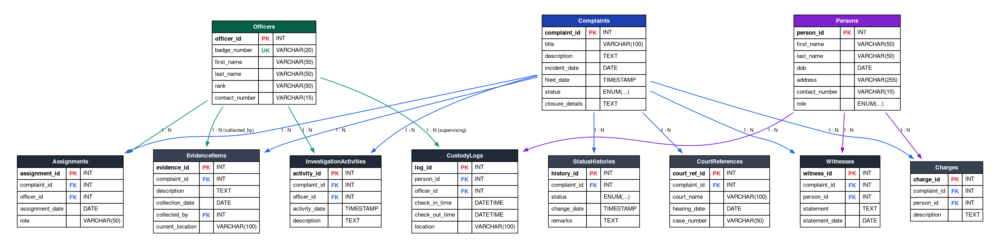

# Police Complaint and Evidence Tracking System

This project is a relational database management system built for a Police Station to track complaints, officers, investigation activities, evidence, and custody logs.

---

## 📹 Video Presentation
- **Project Presentation & Demo:** [Watch on Google Drive](https://drive.google.com/drive/folders/1Nxk43M4bApfIGSRDkxYQHpGEXiWmW15y)

---

## 📊 Entity-Relationship (ER) Diagram

### Visual Representation

```mermaid
erDiagram
    COMPLAINTS ||--o{ STATUS_HISTORIES : "tracks status"
    COMPLAINTS ||--o{ ASSIGNMENTS : "assigned to"
    COMPLAINTS ||--o{ INVESTIGATION_ACTIVITIES : "logs"
    COMPLAINTS ||--o{ EVIDENCE_ITEMS : "contains"
    COMPLAINTS ||--o{ WITNESSES : "records"
    COMPLAINTS ||--o{ COURT_REFERENCES : "referred to"
    COMPLAINTS ||--o{ CHARGES : "files"

    OFFICERS ||--o{ ASSIGNMENTS : "undertakes"
    OFFICERS ||--o{ INVESTIGATION_ACTIVITIES : "conducts"
    OFFICERS ||--o{ EVIDENCE_ITEMS : "collected by"
    OFFICERS ||--o{ CUSTODY_LOGS : "supervises"

    PERSONS ||--o{ CUSTODY_LOGS : "detained in"
    PERSONS ||--o{ WITNESSES : "provides statement"
    PERSONS ||--o{ CHARGES : "charged with"

    COMPLAINTS {
        int complaint_id PK
        string title
        text description
        date incident_date
        timestamp filed_date
        string status "pending | under_investigation | closed | referred_to_court"
        text closure_details
    }

    OFFICERS {
        int officer_id PK
        string badge_number UK
        string first_name
        string last_name
        string rank
        string contact_number
    }

    PERSONS {
        int person_id PK
        string first_name
        string last_name
        date dob
        string address
        string contact_number
        string role "suspect | victim | witness | other"
    }

    ASSIGNMENTS {
        int assignment_id PK
        int complaint_id FK
        int officer_id FK
        date assignment_date
        string role
    }

    INVESTIGATION_ACTIVITIES {
        int activity_id PK
        int complaint_id FK
        int officer_id FK
        timestamp activity_date
        text description
    }

    EVIDENCE_ITEMS {
        int evidence_id PK
        int complaint_id FK
        text description
        date collection_date
        int collected_by FK
        string current_location
    }

    CUSTODY_LOGS {
        int log_id PK
        int person_id FK
        int officer_id FK
        datetime check_in_time
        datetime check_out_time
        string location
    }

    WITNESSES {
        int witness_id PK
        int complaint_id FK
        int person_id FK
        text statement
        date statement_date
    }

    COURT_REFERENCES {
        int court_ref_id PK
        int complaint_id FK
        string court_name
        date hearing_date
        string case_number
    }

    CHARGES {
        int charge_id PK
        int complaint_id FK
        int person_id FK
        text description
    }

    STATUS_HISTORIES {
        int history_id PK
        int complaint_id FK
        string status
        timestamp change_date
        text remarks
    }
```


<details>
<summary><b>Click to view interactive Mermaid ER Diagram</b></summary>


</details>

### Key Entities & Relations
1. **Core Entities**:
   - `Complaints`: Tracks cases, incident dates, status, and mandatory closure details.
   - `Officers`: Law enforcement personnel assigned to cases, activities, and custody.
   - `Persons`: Individuals categorized into roles (`suspect`, `victim`, `witness`, `other`).
2. **Associative & Tracking Entities**:
   - `Assignments`: M:N link between Complaints and Officers with specific assignment roles.
   - `InvestigationActivities`: Chronological audit trail of officer actions on a complaint.
   - `EvidenceItems`: Physical and digital evidence items linked to complaints and collectors.
   - `CustodyLogs`: Detailed check-in/out logs for detained suspects with officer supervision.
   - `Witnesses`: Records statements taken from persons connected to complaints.
   - `Charges`: Legal charges pressed against suspects for specific complaints.
   - `CourtReferences`: Case transfer and trial details for cases referred to the judiciary.
   - `StatusHistories`: Full history of case transitions and remarks over time.

---

## Features
- **Normalized Relational Database (3NF)**: Covers Complaints, Persons, Officers, Assignments, Activities, Evidence, Custody, Witnesses, Court, Charges, and Statuses.
- **Constraints & Business Rules Enforced**: Unique IDs, proper foreign key cascades, date validations, checking complete custody transfers, closure detail requirements.
- **Python-Streamlit Frontend**: A simple interactive dashboard with visualization, CRUD capabilities, and reporting elements.
- **Meaningful Queries**: Contains nested queries, JOINS, aggregation functions (for Officer load, case timeline, and active evidence locations).

---

## Setup Instructions

### 1. Database Setup
You need MySQL Server running.
1. Open your terminal or MySQL Workbench.
2. Run the `schema.sql` script to create the `police_db` database, tables, and insert sample data.
   ```bash
   mysql -u root -p < schema.sql
   ```

### 2. Python Environment
Make sure you have Python 3 installed.
1. Navigate to the project directory.
2. Install the required libraries:
   ```bash
   pip install -r requirements.txt
   ```

### 3. Database Connection Configuration
If your MySQL root password is not `password`, you will need to update the environment variables or edit `database.py`:
- Open `database.py`.
- Update `DB_PASSWORD = os.getenv("DB_PASSWORD", "your_password_here")` with your actual MySQL password.

### 4. Run the Application
1. Start the Streamlit application by running:
   ```bash
   streamlit run app.py
   ```
2. Open your web browser to the provided local URL (usually `http://localhost:8501`).

---

## Deliverables Met:
- **Review 1**: Comprehensive ER diagram & normalized schema design (visual diagram included in README and full DDL in `schema.sql`).
- **Review 2**: Normalized database design (up to 3NF) with constraints, data insertion, and queries (demonstrated in `app.py`).
- **Review 3**: Streamlit application written in Python (`app.py`), connected to the database to handle case management, reporting, error handling, and CRUD operations.
- **Review 4 / Presentation**: [Video Presentation Link (Google Drive)](https://drive.google.com/drive/folders/17LBJrhSpOq3McUwLoAsSTsSQykfUngDV)
